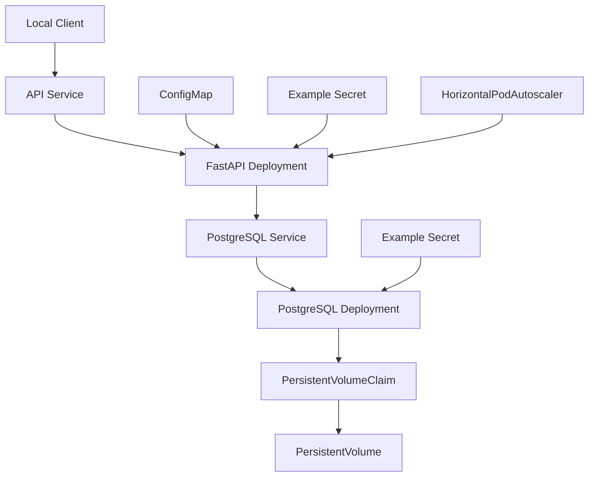

# FastAPI + PostgreSQL on Kubernetes

**Cloud-native deployment case focused on orchestration, persistence, configuration and reliability foundations.**

Kubernetes · Kind · FastAPI · PostgreSQL · Docker · HPA · Probes

## Engineering goal

This project deploys a containerized FastAPI application connected to PostgreSQL in a local Kind cluster. It demonstrates the Kubernetes primitives required to move beyond simply starting containers: service discovery, configuration, persistent data, health probes and horizontal autoscaling.

## Architecture



The API resolves PostgreSQL through Kubernetes DNS:

```text
postgres-svc.desafio-db.svc.cluster.local:5432
```

## Reliability foundations

- **Liveness probe** — verifies whether the application remains alive.
- **Readiness probe** — controls whether a pod is ready to receive traffic.
- **HPA** — demonstrates horizontal scaling configuration for the API.
- **Persistent storage** — separates database lifecycle from pod lifecycle through PV/PVC.
- **Service discovery** — API-to-database communication uses Kubernetes internal DNS.
- **Configuration separation** — ConfigMaps and example Secret manifests keep runtime configuration outside application code.

## Kubernetes resources

| Area | Resources |
| --- | --- |
| API | Deployment, Service, ConfigMap, example Secret, HPA |
| Database | Deployment, Service, example Secret, PV, PVC |
| Cluster | Kind cluster configuration, separate namespaces |

## Repository structure

```text
api/
  Dockerfile
  main.py
  requirements.txt
api-configmap.yaml
api-deployment.yaml
api-hpa.yaml
api-secret.example.yaml
db-deployment.yaml
db-pv.yaml
db-secret.example.yaml
kind-cluster.yaml
```

## Run locally

Create the cluster and namespaces:

```bash
kind create cluster --config kind-cluster.yaml
kubectl create namespace desafio-api
kubectl create namespace desafio-db
```

Build and load the API image:

```bash
cd api
docker build -t desafio-api:v1 .
kind load docker-image desafio-api:v1 --name desafio-cluster
cd ..
```

Apply database resources:

```bash
kubectl apply -f db-secret.example.yaml
kubectl apply -f db-pv.yaml
kubectl apply -f db-deployment.yaml
```

Apply API resources:

```bash
kubectl apply -f api-configmap.yaml
kubectl apply -f api-secret.example.yaml
kubectl apply -f api-deployment.yaml
kubectl apply -f api-hpa.yaml
```

Expose the service locally:

```bash
kubectl port-forward svc/api-svc 8080:80 -n desafio-api
```

## Validate the deployment

```bash
kubectl get pods -n desafio-api
kubectl get pods -n desafio-db
kubectl get svc -n desafio-api
kubectl get svc -n desafio-db
kubectl get hpa -n desafio-api
kubectl logs -f deployment/api -n desafio-api
```

Application checks:

```bash
curl http://localhost:8080/status
curl -X POST "http://localhost:8080/dados?info=hello"
curl http://localhost:8080/dados
```

## Security boundary

Real Secret manifests are intentionally excluded from Git. Only `*.example.yaml` files belong in the public repository. This project is designed for local study and portfolio demonstration rather than a production-cluster claim.

## Skills demonstrated

**Kubernetes** — workloads, Services, namespaces, configuration and autoscaling  
**Reliability foundations** — liveness, readiness and operational checks  
**Data** — PostgreSQL with persistent storage  
**Backend** — containerized FastAPI service
